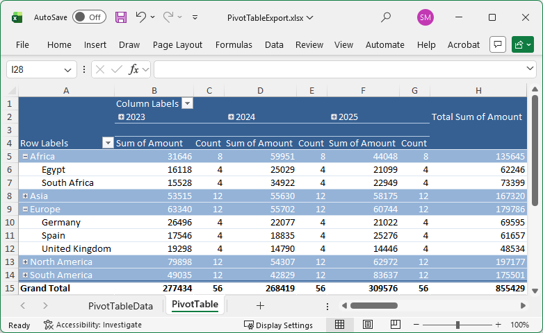

<!-- default badges list -->

[](https://supportcenter.devexpress.com/ticket/details/T1332087)
[](https://docs.devexpress.com/GeneralInformation/403183)
[](#does-this-example-address-your-development-requirementsobjectives)
<!-- default badges end -->
# Blazor Pivot Table - Export Data to Excel Using Spreadsheet Document APIs

This example exports data from the [DevExpress Blazor Pivot Table](https://docs.devexpress.com/Blazor/405245/components/pivot-table) component to an Excel workbook. Once an export operation is complete, the application downloads the generated file.

> **Note**: This example uses the [DevExpress Office File API](https://docs.devexpress.com/Blazor/404576/components/office-file-api) - a standalone library that allows you to read/write documents, spreadsheets, presentations, and PDF files. The DevExpress Office File API is included in the following subscriptions: [DevExpress Office File API Subscription](https://www.devexpress.com/products/net/office-file-api/) or [DevExpress Universal Subscription](https://www.devexpress.com/subscriptions/universal.xml).



## Implementation Details

### Set Up Your Pivot Table

Add a [DevExpress Blazor Pivot Table](https://docs.devexpress.com/Blazor/405245/components/pivot-table) and populate it with data:

```Razor
<DxPivotTable Data="@PivotTableData" @ref="pivotTable">
    <Fields>
        <DxPivotTableField Area="PivotTableArea.Row"
                           Field="@nameof(SaleInfo.Region)"
                           SortOrder="PivotTableSortOrder.Descending" />
        <DxPivotTableField Area="PivotTableArea.Row"
                           Field="@nameof(SaleInfo.Country)" />
        <DxPivotTableField Area="PivotTableArea.Column"
                           Field="@nameof(SaleInfo.Date)"
                           GroupInterval="PivotTableGroupInterval.DateYear"
                           Caption="Year" />
        <DxPivotTableField Area="PivotTableArea.Column"
                           Field="@nameof(SaleInfo.Date)"
                           GroupInterval="PivotTableGroupInterval.DateQuarter"
                           Caption="Quarter" />
        <DxPivotTableField Area="PivotTableArea.Data"
                           Field="@nameof(SaleInfo.Amount)"
                           SummaryType="PivotTableSummaryType.Sum"
                           CellFormat="C0" />
        <DxPivotTableField Area="PivotTableArea.Data"
                           Field="@nameof(SaleInfo.OrderId)"
                           SummaryType="PivotTableSummaryType.Count"
                           Caption="Count" />
    </Fields>
</DxPivotTable>

@code {
    IPivotTable pivotTable { get; set; } = null!;
    SaleInfo[]? PivotTableData;

    protected override void OnInitialized() {
        // Assign data to PivotTableData here
    }
}
```

### Add an Export Button

Add a [DevExpress Blazor Button](https://docs.devexpress.com/Blazor/405052/components/utility-controls/button) to the page. Do the following in the button Click event handler:

1. Obtain the dataset bound to our Blazor Pivot Table. 
1. Call the [DxPivotTable.SaveLayout](https://docs.devexpress.com/Blazor/DevExpress.Blazor.PivotTable.DxPivotTable.SaveLayout) method to retrieve persisted layout information (a [PivotTablePersistentLayout](https://docs.devexpress.com/Blazor/DevExpress.Blazor.PivotTable.PivotTablePersistentLayout) object).
1. Create a `PivotTableExportConfig` object to store custom export options.
1. Pass dataset, layout information, and export options as parameters to the `ExportToExcel` method.
1. Once the export engine returns a generated Excel document, download it to the user machine.

```Razor
<DxButton Text="Export to Excel" Click="OnExportClick" />

@code {
    async Task OnExportClick() {
        var layout = pivotTable.SaveLayout();
        var exportConfig = new Services.PivotTableExportConfig {
            // Changes the `OrderId` field summary type to `Count`
            DataFieldConfigs = new() {
                ["OrderId"] = new Services.DataFieldConfig {
                    SummaryFunction = DevExpress.Spreadsheet.PivotDataConsolidationFunction.Count,
                    Caption = "Count"
                }
            },
            // Groups the `Date` column by years and quarters
            ColumnFieldGroupings = new() {
                ["Date"] = new Services.ColumnFieldGroupingConfig {
                    GroupBy = DevExpress.Spreadsheet.PivotFieldGroupByType.Years | DevExpress.Spreadsheet.PivotFieldGroupByType.Quarters
                }
            }
        };
        var fileBytes = ExportService.ExportToExcel(PivotTableData, layout, exportConfig);

        using var stream = new MemoryStream(fileBytes);
        using var streamRef = new DotNetStreamReference(stream);
        await JS.InvokeVoidAsync("downloadFileFromStream", "PivotTableExport.xlsx", streamRef);
    }
}
```

### Implement an Export Engine

To export Blazor Pivot Table data to Excel, you must:

1. Create a [Workbook](https://docs.devexpress.com/OfficeFileAPI/DevExpress.Spreadsheet.Workbook) instance and access the first worksheet.

    ```cs
    using var workbook = new Workbook();
    var dataSheet = workbook.Worksheets[0];
    ```
1. Iterate through dataset properties and create corresponding header cells in the worksheet.

    ```cs
    var properties = typeof(T).GetProperties();
    for (int col = 0; col < properties.Length; col++) {
        dataSheet.Cells[0, col].Value = properties[col].Name;
    }
    ```

1. Iterate through dataset records and populate worksheet cells with associated values.

    ```cs
    var dataList = data.ToList();
    for (int row = 0; row < dataList.Count; row++) {
        for (int col = 0; col < properties.Length; col++) {
            var value = properties[col].GetValue(dataList[row]);
            var cell = dataSheet.Cells[row + 1, col];
            switch (value) {
                case int intVal:
                    cell.Value = intVal;
                    break;
                case DateTime dateVal:
                    cell.Value = dateVal;
                    cell.NumberFormat = "m/d/yyyy";
                    break;
                case string strVal:
                    cell.Value = strVal;
                    break;
            }
        }
    }
    ```

1. Add a new worksheet and create a [Spreadsheet Pivot Table](https://docs.devexpress.com/OfficeFileAPI/118492/spreadsheet-document-api/pivot-tables) based on data listed in the first worksheet.

    ```cs
    int lastRow = dataList.Count;
    int lastCol = properties.Length - 1;
    var sourceRange = dataSheet.Range.FromLTRB(0, 0, lastCol, lastRow);

    var pivotSheet = workbook.Worksheets.Add("PivotTable");
    workbook.Worksheets.ActiveWorksheet = pivotSheet;
    var pivotTable = pivotSheet.PivotTables.Add(sourceRange, pivotSheet["A1"]);
    ```

1. To recreate our Blazor Pivot Table's layout, iterate through [persistent layout fields](https://docs.devexpress.com/Blazor/DevExpress.Blazor.PivotTable.PivotTablePersistentLayout.Fields) and add them to corresponding Spreadsheet Pivot Table areas.

    ```cs
    var layoutFields = layout.Fields
        .Where(f => f.Area.HasValue && f.Visible != false)
        .OrderBy(f => f.AreaIndex)
        .ToList();
    var addedColumnFields = new HashSet<string>(StringComparer.OrdinalIgnoreCase);

    foreach (var layoutField in layoutFields) {
        var fieldName = layoutField.Field;
        var pivotField = FindPivotField(pivotTable, fieldName);

        switch (layoutField.Area) {
            case PivotTableArea.Row:
                pivotTable.RowFields.Add(pivotField);
                break;
            case PivotTableArea.Column:
                pivotTable.ColumnFields.Add(pivotField);
                break;
            case PivotTableArea.Data:
                pivotTable.DataFields.Add(pivotField);
                break;
            case PivotTableArea.Filter:
                pivotTable.PageFields.Add(pivotField);
                break;
        }
    }
    ```

1. _Optional._ Customize exported data fields based on configuration object settings.

    ```cs
    switch (layoutField.Area) {
        case PivotTableArea.Data:
            var dataField = pivotTable.DataFields.Add(pivotField);
            if (config.DataFieldConfigs.TryGetValue(fieldName, out var dfConfig)) {
                dataField.SummarizeValuesBy = dfConfig.SummaryFunction;
                if (!string.IsNullOrEmpty(dfConfig.Caption))
                    dataField.Name = dfConfig.Caption;
            }
            break;
        //...
    }
    ```

1. _Optional._ Call the [GroupItems](https://docs.devexpress.com/OfficeFileAPI/DevExpress.Spreadsheet.PivotField.GroupItems(DevExpress.Spreadsheet.PivotFieldGroupByType)) method to group exported date fields.

    ```cs
    foreach (var kvp in config.ColumnFieldGroupings) {
        var pivotField = FindPivotField(pivotTable, kvp.Key);
        if (pivotField != null)
            pivotField.GroupItems(kvp.Value.GroupBy);
    }
    ```

1. Call the [SaveDocument{Async}](https://docs.devexpress.com/OfficeFileAPI/DevExpress.Spreadsheet.Workbook.SaveDocument.overloads?p=netframework) method to export the generated document.

    ```cs
    using var stream = new MemoryStream();
    workbook.SaveDocument(stream, DocumentFormat.Xlsx);
    return stream.ToArray();
    ```


## Files to Review

* [Index.razor](./Pages/Index.razor)
* [PivotTableExportService.cs](./Services/PivotTableExportService.cs)

## Documentation

- [DevExpress Blazor Pivot Table](https://docs.devexpress.com/Blazor/405245/components/pivot-table)
- [DevExpress Blazor Pivot Table - Save and Restore Layout](https://docs.devexpress.com/Blazor/405458/components/pivottable/save-and-restore-layout)
- [DevExpress Office File API - Spreadsheet Pivot Tables](https://docs.devexpress.com/OfficeFileAPI/118492/spreadsheet-document-api/pivot-tables)
<!-- feedback -->
## Does This Example Address Your Development Requirements/Objectives?

[](https://www.devexpress.com/support/examples/survey.xml?utm_source=github&utm_campaign=blazor-pivot-table-export-to-excel&~~~was_helpful=yes) [](https://www.devexpress.com/support/examples/survey.xml?utm_source=github&utm_campaign=blazor-pivot-table-export-to-excel&~~~was_helpful=no)

(you will be redirected to DevExpress.com to submit your response)
<!-- feedback end -->
